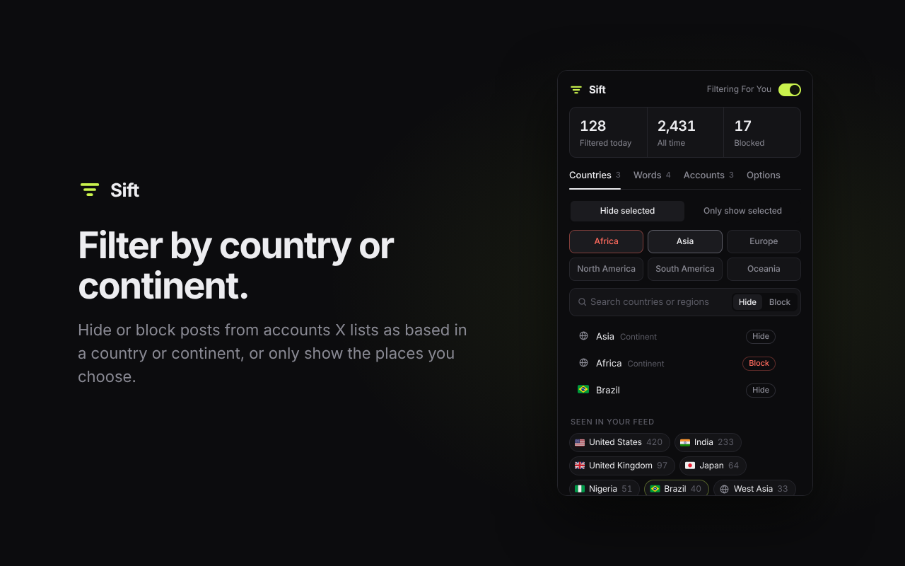

<p align="center">
  
</p>

<h1 align="center">Sift</h1>

<p align="center">Filter your X For You feed by country, continent, words and accounts.</p>

<p align="center">
  
</p>

## Features

- **Country filtering.** X shows where an account is based in its *About this account* panel. Sift reads that for each author in your feed. Then it either hides or blocks posts from the countries, regions or whole continents you pick, or shows only the ones you allow.
- **Continents.** One click covers Africa, Asia, Europe, North America, South America or Oceania, including the regions X reports, like "West Asia". A rule for a specific country overrides its continent.
- **Location on every post.** Each author's flag and country appear right after their name, everywhere on X, including quoted posts. You can switch to flag only. Flags render properly on Windows too.
- **Word rules.** Words, phrases or `/regex/`. Matching is whole-word, so `crypto` won't catch "cryptography".
- **Account rules.** Hide, block or always allow specific accounts. You can also right-click any profile link on X.
- **Hide or block.** Any rule can just hide posts, or block the author on X for you. Auto-block is off until you turn it on.
- **Clean up.** Drop promoted posts, "Who to follow", verified accounts and reposts.
- **Collapse or remove.** Filtered posts either collapse to a slim bar with **Show** and **Block** buttons, or disappear completely.
- Only touches the **For You** tab by default. Rules can be imported and exported as JSON.

## Install

**Chrome Web Store:** *coming soon*

**From source** (Chrome, Edge, Brave, any Chromium browser 111+):

1. Download this repo (Code → Download ZIP) and unzip it.
2. Open `chrome://extensions` and turn on **Developer mode**.
3. Click **Load unpacked** and select the folder that contains `manifest.json`.

## How country lookups work

X only allows about **50 "About this account" lookups per account every 15 minutes**, so Sift can't ask X about every author. Instead:

1. **Profile location first.** X's feed and reply data already include each author's profile location ("Austin, TX", "London 🇬🇧", "Lagos"). Sift reads a copy of that data in your browser and turns clear matches into a country instantly, at no lookup cost. These labels are slightly faded. Ambiguous text like "London, ON" or "Earth" is ignored. You can turn this off in Options.
2. **X's own answer when it matters.** The 50 real lookups go to the authors that need them most. First come posts just below your screen (so filtering is ready before you scroll to them), then authors with no usable profile location, then confirming guesses. X's "Account based in" always replaces a profile guess.
3. **One shared budget.** All your X tabs share the budget through the background script. The first half of each window is spent quickly, and the rest is spread over the remaining minutes. The popup shows how many lookups are left and when they refill.
4. **Nothing disappears while you read.** Once a post has been on screen for half a second, a late answer can no longer hide it. Late answers only filter posts further down that you haven't reached yet.

Locations are cached on your device: X's answers for 30 days, profile guesses for 7 days. When X changes its lookup ID, Sift picks up the new one from X's own requests.

## Privacy

Everything stays in your browser. Sift has no server, no analytics and no tracking. See [PRIVACY.md](PRIVACY.md).

## Building a store package

```powershell
./build.ps1          # Windows → dist/sift-<version>.zip
```
```bash
./build.sh           # macOS / Linux
```

## Credits

- Flag glyphs come from [Twemoji](https://github.com/twitter/twemoji) (CC-BY 4.0), packaged as a font by [country-flag-emoji-polyfill](https://github.com/talkjs/country-flag-emoji-polyfill) (MIT).

Sift isn't affiliated with or endorsed by X Corp.

## License

MIT © RamenNuudls
